# 📊 Customer Churn Prediction

**An end-to-end churn system that goes past "who will churn?" to "when, why, and
what should we do about it with this budget?"** A calibrated scikit-learn model
(chosen by cross-validation) scores telecom customers in real time through a
FastAPI service and a Streamlit dashboard. Every prediction comes with signed
explanations and a what-if search for realistic changes that would lower the
risk. A survival model estimates *when* a customer is likely to leave, and a
budget optimiser decides which customers should get which retention offer. Every
model version is registered with its metrics, a fairness report and a model card,
and new data is checked for drift. Typed (mypy strict), tested (203 tests, 94%
coverage) and containerised.

> **Live demo:** _coming soon — add the Streamlit Community Cloud URL here_ ([how to deploy](docs/DEPLOYMENT.md))

[](https://www.python.org/)
[](https://scikit-learn.org/)
[](https://fastapi.tiangolo.com/)
[](https://streamlit.io/)
[](LICENSE)

---

## Contents

1. [Screenshots](#-screenshots)
2. [Results](#-results)
3. [Architecture](#-architecture)
4. [Features](#-features)
5. [Quick start](#-quick-start)
6. [Usage](#-usage)
7. [Key design decisions](#-key-design-decisions)
8. [Limitations and future work](#-limitations-and-future-work)
9. [Project structure](#-project-structure)
10. [Dataset](#-dataset)
11. [Further reading](#-further-reading)

---

## 📸 Screenshots

_Placeholders: capture these from `streamlit run app.py` and save them under
`docs/images/`._

- [ ] `docs/images/demo.gif`: a 20-second walk-through (fill in the form → result
  → factors → what-if → retention planner)
- [ ] `docs/images/prediction.png`: Prediction page with KPI cards, risk banner and
  the red/green factor chart
- [ ] `docs/images/whatif.png`: "What would reduce this risk?" table
- [ ] `docs/images/retention.png`: Retention Planner with budget slider and the
  expected-saving-by-budget chart
- [ ] `docs/images/survival.png`: Time to Churn page with Kaplan-Meier curves by
  contract
- [ ] `docs/images/performance.png`: Model Performance with confusion matrix,
  calibration curve and fairness table
- [ ] `docs/images/monitoring.png`: Monitoring page with green/amber/red PSI
- [ ] `docs/images/api-docs.png`: FastAPI `/docs` page

---

## 📈 Results

All numbers below come from the registered model version `20261105T043413Z`
(`python -m churn train`; 5,634 training rows, 1,409 held-out test rows, random
seed 42) and from running the CLI and API against it.

### Model selection (5-fold cross-validation on the training set)

| Model | ROC-AUC | PR-AUC | F1 | Recall | Precision |
| --- | --- | --- | --- | --- | --- |
| Random forest | 0.8464 | 0.6608 | 0.6299 | 0.7371 | 0.5501 |
| **Logistic regression (selected)** | **0.8463** | **0.6642** | **0.6281** | **0.7980** | **0.5181** |
| Histogram gradient boosting | 0.8450 | 0.6619 | 0.6338 | 0.7773 | 0.5352 |

ROC-AUC ties to three decimals, so the tie-break is recall (catching churners is
what the business needs), which selects logistic regression.

### Held-out test set

| Metric | Tuned threshold (0.35) | Default threshold (0.50) |
| --- | --- | --- |
| Recall | **0.717** | 0.508 |
| Precision | 0.555 | 0.648 |
| F1 | **0.625** | 0.570 |
| Accuracy | 0.772 | 0.796 |

ROC-AUC **0.842** · PR-AUC **0.635** · Brier score **0.138** (sigmoid-calibrated).
Tuning the threshold catches 268 of 374 test churners instead of 190.

### Time to churn (Cox proportional hazards)

| Metric | Value |
| --- | --- |
| Concordance index, test / train | **0.845** / 0.858 |
| Still active after 12 months (Kaplan-Meier) | month-to-month 70%, one-year 99%, two-year 100% |
| Hazard ratio, two-year vs. month-to-month contract | 0.075 |
| Proportional-hazards violations (p < 0.05) | 6 of 14 covariates (reported, see limitations) |

### Retention budget (full Telco file, offer assumptions in `churn/config.py`)

Expected net saving, with the share of the proven upper bound in brackets:

| Budget | Optimised (Lagrangian) | Greedy by ratio | Top-N by risk (baseline) |
| --- | --- | --- | --- |
| 5,000 | **35,822** (~100%) | 35,822 (100%) | 14,113 (39%) |
| 20,000 | **108,600** (~100%) | 99,975 (92%) | 51,507 (47%) |
| 60,000 | **242,360** (~100%) | 120,792 (50%) | 129,669 (54%) |

These depend entirely on the assumed offer costs and success rates, which are
placeholders, not measured results.

### Fairness (test set, tuned threshold)

| Attribute | Recall by group | Flag (gap > 0.10) |
| --- | --- | --- |
| gender | Female 0.684 · Male 0.751 | none |
| SeniorCitizen | 0: 0.670 · 1: 0.847 | recall, FPR |
| Partner | No 0.774 · Yes 0.603 | recall, FPR |

The flagged groups also have very different churn rates (seniors 44% vs. 23%,
no partner 34% vs. 19%); see the model card for the interpretation.

### Serving

`POST /predict`: median **46 ms**, p95 76 ms end to end, of which the model
call is a median of 22 ms (300 requests, in-process test client on a laptop).

---

## 🏗 Architecture

```mermaid
flowchart LR
    subgraph Training ["Training: python -m churn train"]
        D[(Telco CSV)] --> C[clean + stratified split]
        C --> CV[3 candidates x grid search<br/>5-fold CV]
        CV --> SEL[select: ROC-AUC, recall tie-break]
        SEL --> CAL[calibrate + tune threshold]
        CAL --> EV[test report · fairness report]
        C --> SV[Kaplan-Meier + Cox model]
    end

    EV --> REG[(Model registry<br/>models/registry/version/<br/>model · survival · manifest · model card)]
    SV --> REG

    subgraph Serving
        REG --> API[FastAPI service<br/>/predict · /predict/batch<br/>/explain/whatif · /retention/plan<br/>/health · /model · /metrics]
        REG --> CLI[CLI<br/>predict · score · plan · drift · registry]
        REG --> UI[Streamlit dashboard<br/>7 pages]
        UI -. optional CHURN_API_URL .-> API
    end

    subgraph Logic ["Shared logic in churn/"]
        EXP[explanations<br/>coefficients / SHAP]
        CF[counterfactual what-if]
        RET[retention optimiser]
        VAL[validation + PSI drift]
    end

    API --- Logic
    UI --- Logic
    CLI --- Logic
```



---

## ✨ Features

| Area | What it does | Code |
| --- | --- | --- |
| **Model** | Logistic regression, random forest and gradient boosting in one sklearn `Pipeline` each; grid search with 5-fold CV; probability calibration (sigmoid/isotonic by CV Brier); decision threshold tuned on out-of-fold predictions. | `churn/model.py`, `churn/evaluate.py`, `churn/train.py` |
| **Explanations** | Signed per-customer contributions: coefficient x value for linear models, SHAP (`TreeExplainer`) for tree models, behind one `top_factors` interface. | `churn/predict.py` |
| **What-if** | Searches every combination of realistic changes (longer contract, automatic payment, adding OnlineSecurity/TechSupport, paperless billing) and returns those that lower the risk most. Never changes gender, SeniorCitizen, tenure and other fixed attributes. | `churn/counterfactual.py`, `POST /explain/whatif` |
| **Retention optimiser** | Expected saving = P(churn) x success rate x value − cost; chooses at most one offer per customer within a budget using Lagrangian relaxation, with a proven upper bound; compared against greedy and top-N-by-risk. | `churn/retention.py`, `churn plan`, `POST /retention/plan` |
| **Survival analysis** | Kaplan-Meier curves by contract and a Cox model; concordance index; proportional-hazards test; per-customer "likely months until churn" conditional on current tenure. | `churn/survival.py` |
| **Fairness** | Recall, precision and FPR by gender, SeniorCitizen and Partner, with group churn rates, sample-size margins and a generated interpretation in every model card. | `churn/fairness.py` |
| **Monitoring** | Input validation warnings per request; PSI drift per feature with green/amber/red status and a "retrain recommended" rule. | `churn/validation.py`, `churn drift`, Monitoring page |
| **Registry** | Versioned models with provenance (git SHA, data hash, library versions), model card, `latest` pointer and one-command rollback. | `churn/registry.py` |
| **API** | FastAPI with a request schema generated from one source (`churn/schema.py`), request ids, JSON logs, Prometheus metrics, 422/413/503/500 error contracts. | `churn/service/` |
| **Dashboard** | Seven pages: Prediction, Churn Analysis, Model Performance, Batch Prediction, Retention Planner, Time to Churn, Monitoring. | `churn/ui/` |
| **Quality** | mypy `--strict`, ruff, 203 pytest tests (unit, Hypothesis property tests, API contract tests, dashboard smoke tests), 94% coverage with an 85% gate, pre-commit, CI on Python 3.10–3.12, Docker build, Dependabot. | `tests/`, `.github/` |

---

## 🚀 Quick start

```bash
python -m venv .venv
```

Activate it (`.\.venv\Scripts\Activate.ps1` on Windows, `source .venv/bin/activate`
on Linux/macOS), then:

```bash
pip install -r requirements-dev.txt
```

```bash
python -m churn train
```

```bash
streamlit run app.py
```

Training takes about 40 seconds on a 12-core laptop and registers a model under
`models/registry/`. The dashboard opens at <http://localhost:8501>.

With Docker (API on :8000, dashboard on :8501):

```bash
docker compose run --rm api python -m churn train
```

```bash
docker compose up
```

---

## 🖥 Usage

### Command line

```bash
python -m churn predict --tenure 4 --contract "Month-to-month" --internet-service "Fiber optic"
python -m churn score --input customers.csv --output scored.csv
python -m churn plan --budget 5000 --input customers.csv        # writes retention_plan.csv
python -m churn drift --current customers.csv                   # PSI + retrain signal
python -m churn registry list
python -m churn registry promote <version>                       # rollback
```

### REST API

```bash
python -m churn serve          # http://localhost:8000, interactive docs at /docs
```

| Endpoint | Purpose |
| --- | --- |
| `POST /predict` | Probability, label, risk tier, signed top factors, input warnings |
| `POST /predict/batch` | The same for up to 1,000 customers |
| `POST /explain/whatif` | Realistic changes that would lower this customer's risk |
| `POST /retention/plan` | Which customers get which offer within a budget, with strategy comparison |
| `GET /model` · `GET /health` · `GET /metrics` | Model metadata, liveness (503 without a model), Prometheus metrics |

```bash
curl -X POST localhost:8000/explain/whatif -H "content-type: application/json" \
     -d '{"customer": {"tenure": 2, "Contract": "Month-to-month"}, "max_changes": 2}'
```

### Quality checks

```bash
make check      # ruff, ruff format --check, mypy --strict, pytest with the 85% coverage gate
```

---

## 🧭 Key design decisions

- **One pipeline from raw columns to prediction.** Feature engineering, imputation,
  scaling and one-hot encoding live inside the saved scikit-learn `Pipeline`, so
  training and serving cannot encode a customer differently, and unseen categories
  become an all-zero group instead of an error.
- **Select on ROC-AUC, break ties on recall, tune the threshold.** Accuracy is
  misleading at a 26.5% churn rate. Missing a churner costs more than a spare
  offer, so the threshold is tuned (0.35) rather than left at 0.5.
- **Calibrate the probabilities.** The risk tiers and the budget optimiser's
  expected saving both use P(churn) directly, so a predicted 30% must really mean
  30%. The reliability curve and Brier score are saved with every model.
- **Explanations through one interface.** Linear models get exact coefficient
  contributions for free; tree models get SHAP. The API and UI do not care which.
- **What-if by exhaustive search, not an optimiser.** Five actionable features with
  at most two values each is about 130 candidates: brute force is exact, fast
  (about 0.2 s) and easy to explain. Business rules (contracts only get longer,
  add-ons need internet) keep suggestions realistic.
- **Lagrangian relaxation for the budget.** An exact dynamic programme was tried
  first, but rounding costs to budget steps distorted cheap offers by up to 40%.
  The Lagrangian method needs no rounding and also yields an upper bound, so every
  plan reports how close to optimal it is.
- **Survival analysis without leakage.** `tenure` is the duration and
  `TotalCharges` is roughly tenure x monthly charge, so neither is a Cox covariate.
  Estimates are conditional on the customer's current tenure and are not
  extrapolated past the observed 72 months.
- **Fairness as a report, not a verdict.** With different churn rates across
  groups, equal precision and equal FPR cannot both hold, so gaps are flagged for
  review with base rates and sample-size margins next to them.
- **No pickles in git.** Model binaries are generated (`python -m churn train`) and
  the hosted demo trains on first start; only manifests and model cards are
  committed.
- **One schema, many interfaces.** `churn/schema.py` generates the API's pydantic
  model, the CLI flags and the dashboard form, so they never drift apart.

---

## ⚠️ Limitations and future work

**Limitations**

- **Static, public dataset.** One snapshot of 7,043 customers from a single
  (fictional) telecom company; results may not transfer to other businesses.
- **Associations, not causes.** The what-if search and the hazard ratios describe
  patterns in the data. Moving a customer to a two-year contract is not proven to
  keep them; that needs an experiment.
- **Business assumptions.** Offer costs, success rates and the 12-month value
  horizon are illustrative placeholders, and the optimiser's savings scale with
  them. The what-if search holds monthly charges fixed, so added services look free.
- **Survival data.** Tenure is reconstructed from one snapshot, observed only up
  to 72 months, and covariates are current values. Churn is U-shaped in tenure
  (rising again past ~60 months, in the raw data too), and 6 of 14 covariates
  violate the proportional-hazards assumption.
- **Fairness.** Only three attributes are checked, the senior group has 98
  churners in the test set (recall margin about ±0.07), and no mitigation is
  applied.
- **Drift.** PSI detects input shifts, not changes in the relationship between
  inputs and churn (concept drift); that needs fresh labels.

**Future work**

- Use the survival model's expected remaining lifetime as the customer value in
  the retention optimiser instead of a flat 12 months.
- Learn offer success rates from an A/B test (uplift modelling) instead of assuming them.
- Monitor prediction and label drift from the JSONL prediction log, and retrain on a schedule.
- Add authentication and rate limiting before exposing the API publicly.
- Time-varying Cox model (or stratification by contract) to address the
  proportional-hazards violations.

---

## 📁 Project structure

```
Customer-Churn-Prediction/
├── app.py · api.py              # Streamlit and ASGI entry points
├── churn/
│   ├── config.py · schema.py    # settings (CHURN_* env vars), business assumptions, the 19 inputs
│   ├── data.py · features.py    # loading, cleaning, feature pipeline
│   ├── model.py · evaluate.py · train.py   # candidates, CV, calibration, threshold, training run
│   ├── predict.py · batch.py    # ChurnModel (scoring + explanations), batch scoring
│   ├── counterfactual.py        # what-if search
│   ├── retention.py             # budget optimiser
│   ├── survival.py              # Kaplan-Meier + Cox model
│   ├── fairness.py              # per-group metrics and interpretation
│   ├── validation.py            # input checks, PSI drift, retrain signal
│   ├── registry.py              # versioned model registry
│   ├── cli.py                   # python -m churn ...
│   ├── service/                 # FastAPI app, routes, schemas, middleware, metrics
│   └── ui/                      # one module per dashboard page + shared components and theme
├── tests/                       # 203 tests
├── docs/                        # DEPLOYMENT.md, INTERVIEW_NOTES.md
├── data/Telco-Customer-Churn.csv
├── models/registry/             # manifests and model cards (binaries are generated)
├── notebooks/customer_churn_eda.ipynb
└── Dockerfile · docker-compose.yml · Makefile · pyproject.toml · .pre-commit-config.yaml
```

---

## 🗃 Dataset

[Telco Customer Churn](data/Telco-Customer-Churn.csv): 7,043 customers, 19 input
attributes plus `customerID` and the target `Churn` (1,869 churners, 26.5%). 11
customers have a blank `TotalCharges` (all with tenure 0); it is imputed inside the
pipeline.

| Group | Attributes |
| --- | --- |
| Demographics | `gender`, `SeniorCitizen`, `Partner`, `Dependents` |
| Account | `tenure`, `Contract`, `PaperlessBilling`, `PaymentMethod`, `MonthlyCharges`, `TotalCharges` |
| Services | `PhoneService`, `MultipleLines`, `InternetService`, `OnlineSecurity`, `OnlineBackup`, `DeviceProtection`, `TechSupport`, `StreamingTV`, `StreamingMovies` |

Churn rate by group in the raw data: month-to-month 42.7% vs. two-year 2.8%;
electronic check 45.3% vs. automatic payments 15–17%; fiber 41.9% vs. DSL 19.0%.

---

## 📚 Further reading

- [docs/INTERVIEW_NOTES.md](docs/INTERVIEW_NOTES.md): every component, why it was
  chosen, and likely interview questions with answers
- [docs/DEPLOYMENT.md](docs/DEPLOYMENT.md): deploying the dashboard
- [PROJECT_GUIDE.md](PROJECT_GUIDE.md): configuration reference and troubleshooting
- `models/registry/<version>/model_card.md`: the full report for each model version

## 📄 License

[MIT](LICENSE)
